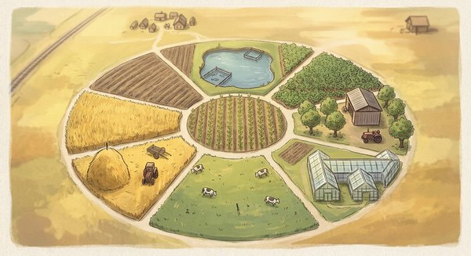

  

★ N.I.C. ★

# NIC-Sluchalo

[English](README.md) · [Čeština](README.cs.md) · **Русский**

**Что в стене — по тени, которую отбрасывает сквозь неё Wi-Fi. Ручная головка с десятью
приёмниками Wi-Fi поворачивается на стержне, прижатом к одной стороне стены, маленькая коробка с другой стороны передаёт.
Кабель, труба или стальной профиль между ними ослабляют поле, и головка показывает, где. Все настройки и все сырые данные
остаются открытыми для того, кто с ней работает.**

> ⚠️ **Концепция — ничего не построено и не измерено.** Для каждой цифры указано, откуда она:
> из даташита, из опубликованной работы, из нашего собственного расчёта — или что она неизвестна.
> Расчёты — это модели (2D и 3D FDTD и более простая физика), а не измерения. Тень кабеля сквозь
> настоящую стену таким способом ещё никто не видел. Вопросы и исправления — вот зачем мы это
> публикуем.

## Как это работает

- **Почему тень, а не радар.** Сигнал проходит стену один раз. Нет эха от ближней поверхности
  и утечки передатчика в приёмник — двух вещей, которые ослепляют односторонний радар.
- **Амплитуды, а не фазы.** Каждый приёмник измеряет канал одного и того же кадра на каждой
  поднесущей (CSI) при фиксированном усилении. Каждый приёмник работает от своего кварца,
  поэтому сравниваются только амплитуды: на каждом кадре приёмники друг с другом — это убирает
  передатчик и комнату; в каждом приёмнике кадры двух скрещённых антенн передатчика друг с
  другом — это убирает собственное усиление приёмника; и за полный оборот каждый приёмник со
  своей окружностью. Волна самого передатчика служит опорой, которая фокусирует изображение,
  как в голограмме.
- **Оборот как сканирование.** Головка делает один оборот на стержне, прижатом к стене, вне
  своего центра, так что каждая из восьми антенн кольца описывает свою окружность, а вместе они
  заполняют круг диаметром около 23 см. Стены головка не касается.
- **Самокритика.** Перед оборотом средняя пара посылает короткий кадр в каждой поляризации, и
  каждый приёмник измеряет, что до него дошло, — против ударов, влажности и ухода.
- **Сетевое напряжение как пробник.** В отдельном режиме, когда прибор держат как пробник,
  ёмкостный датчик звуком и полоской показывает, где кабель под напряжением или сигнал
  трассоискателя; он никогда не утверждает, что напряжения нет.

## Только этот один опыт

Сканеры в продаже собирают всё в одну коробку: Bosch D-tect 200 C сочетает радар с индукционным
датчиком, а тепловизоры показывают, по какому кабелю шёл ток. Sluchalo к этому не стремится: это один
опыт — можно ли нарисовать тень, которую Wi-Fi отбрасывает сквозь стену, — и рядом простой пробник
напряжения. Остальное — трассоискатель, читаемый и по заряду, и по току, металл, простукивание,
тепловизор, наложенный на обычную камеру, — это NIC-Ariadna, отдельный ручной зонд, пока не
опубликованный.

## Части

| часть | что это |
|---|---|
| **Iskra** | искра: передатчик за стеной, готовая плата с двумя скрещёнными антеннами, передающими по очереди, вертикальной и горизонтальной |
| **Fonar** | фонарь: прибор, приложенный к стене, — Valenki и Kolchoz |
|  **Valenki** | валенки: шасси — резиновая ножка, прижатая к стене, стержень и рукоятка; держит головку на расстоянии от стены и перпендикулярно ей |
|  **Kolchoz** | колхоз: головка — всё, что вращается на стержне |
|  **Levša** | Левша Лескова: конструкция, всё металлическое и пластиковое, что держит блоки |
| **Brigáda** | бригада: кольцо из восьми приёмников, **Mužíci** (мужики), у каждого своя антенна — **Kosa**, коса |
|  **Předseda** | председатель (по-чешски): пара в центре под прямым углом — работа двух мужиков — с **Serp** и **Molot**, серпом и молотом, в руках, единственными передатчиками в Fonar, для **Samokritika**, самокритики |
|  **Kuranty** | куранты: шкала времени — один фронт на линии, общей для всех приёмников |
|  **Razvedčik** | разведчик: датчик угла поворота головки на стержне |
| **Iljič** | лампочка Ильича: блок сетевого напряжения — ёмкостный датчик со своим усилением и полосой, отдельный режим, держится как пробник |
| **Gensek** | генсек: один процессор над всем — отчёты, угол, изображение, дисплей, звук |
| **Pravda** | «Правда»: дисплей и кнопки |
| **Matjugalnik** | матюгальник (солдатский жаргон): звук — что показывают картинка и Iljič, на слух, тоном и громкостью, какие задаст пользователь |
| **Kádrovák** | кадровик (по-чешски): хранилище каждого изображения с его сырыми данными; **Samizdat**, самиздат, выносит их на компьютер |
| **Pajok** | паёк: два элемента 18650 |
| **Karanténa** | карантин: надзор за всеми блоками, **Felčar**, фельдшер, — его проверки; при неисправности прибор прекращает измерение |

## Головка

| | |
|---|---|
| размер | около 18 см в диаметре |
| кольцо | **Brigáda**: восемь покупных двухдиапазонных антенн (2,4 и 5 ГГц), каждая повёрнута радиально |
| центр | **Předseda**: две такие же антенны под прямым углом, вокруг центра |
| стержень | между центром и кольцом; один оборот покрывает круг диаметром около 23 см |
| разметка | карандашом по вырезам на краю головки, когда она остановлена |
| приёмники | десять готовых модулей ESP32-C5, каждый на своём кварце, каждый соединён со своей антенной коротким кабелем |
| Front | лицевая сторона к стене: металлический диск с тонким изолирующим слоем, на нём антенны — диск служит им землёй и экраном |
| Tyl | плата за ним: процессор, питание, дисплей, звук |
| к стене | не касается её: **Valenki** держит её на расстоянии; там, где головка может задеть стену, на ней войлок |
| питание | от двух элементов 18650 около трёх часов |

Концепция от 28.10 ([`concept.md`](concept.md), по-английски) описывает прежнюю головку — девять
собственных патчей, одни часы на всех, на пене, скользящую по стене; где она расходится с
уровнями, верны уровни ([`WHY.md`](WHY.md)). Расположение головки перерисовывается под покупные
антенны; [`calc/ring8.py`](calc/ring8.py) содержит его для прежних патчей.

## Что неизвестно

- **Ведёт ли себя настоящая стена как модели** — проницаемость настоящего раствора и штукатурки,
  мокрые швы и удерживает ли 8-битный CSI при фиксированном усилении изменение амплитуды на
  20–30 % стабильно.
- **Рисуют ли одни амплитуды, без общих часов, настоящую стену** так же хорошо, как модельную.

**Опыт, который это решит:** две готовые платы с ESP32-C5, одна передаёт за стеной, другая
слушает перед ней, усиление закреплено, CSI пишет ноутбук; кабель и гофра за гипсокартоном и
в штробе кирпичной стены, оба диапазона, обе поляризации; затем принимающая антенна на металле,
как на головке, и поворачиваемая рукой вокруг стержня, как поворачивается головка. Опыт пройден,
если кабель даёт на своём месте повторяемый провал не меньше 2 дБ сверх собственного рисунка
стены и при повороте пересекает круг антенны под верными углами каждый раз. Если не пройден,
проект останавливается. (Испытания в конце [`concept.md`](concept.md) — прежние.)

## Что дальше

Проект растёт по уровням. Назначение, требования, архитектура, принцип — грубо рассчитанная
физика каждого блока — и детали, везде, где можно, покупные и готовые, закрыты. Осталось собрать
испытания и измерять.
Espressif, авторам ESPARGOS, на форумы, — а испытания соберём, как только сможем. Проект будет
расти по тому, что они покажут, и настолько, насколько позволят время и средства.

## Файлы

- [`purpose.md`](purpose.md) — что он делает, для кого и как мы узнаем, что он работает; одна страница, по-английски.
- [`requirements.md`](requirements.md) — что он должен уметь, в диапазонах; по-английски.
- [`architecture.md`](architecture.md) — тела, блоки и что между ними передаётся; названия; по-английски.
- [`principle.md`](principle.md) — физика каждого блока, грубо рассчитанная, и что осталось измерить; по-английски.
- [`parts.md`](parts.md) — детали, каждая с требованием, которое она выполняет; по-английски.
- [`WHY.md`](WHY.md) — почему закрытые уровни были открыты заново и что это изменило ниже; по-английски.
- [`concept.md`](concept.md) — вся концепция, по-английски: для чего она, головка, почему это
  должно работать, электроника, звук, тепло, отвергнутые пути и почему, что неизвестно,
  испытания.
- [`calc/`](calc) — скрипты за каждой рассчитанной цифрой, Python 3 с numpy (два из них со
  scipy), и их результаты. `budget.py`, `array.py`, `acoustics.py` и `cpu.py` отрабатывают сразу;
  модели FDTD считают от минут до часа на случай.

Программы под лицензией MIT ([`LICENSE`](LICENSE)); проект аппаратуры под CERN-OHL-P v2
([`LICENSE-HW`](LICENSE-HW)).

## Благодарности

ИИ-ассистенту Claude (Anthropic) — за большую помощь в работе над этим проектом.

★ Viva La Resistánce ★
