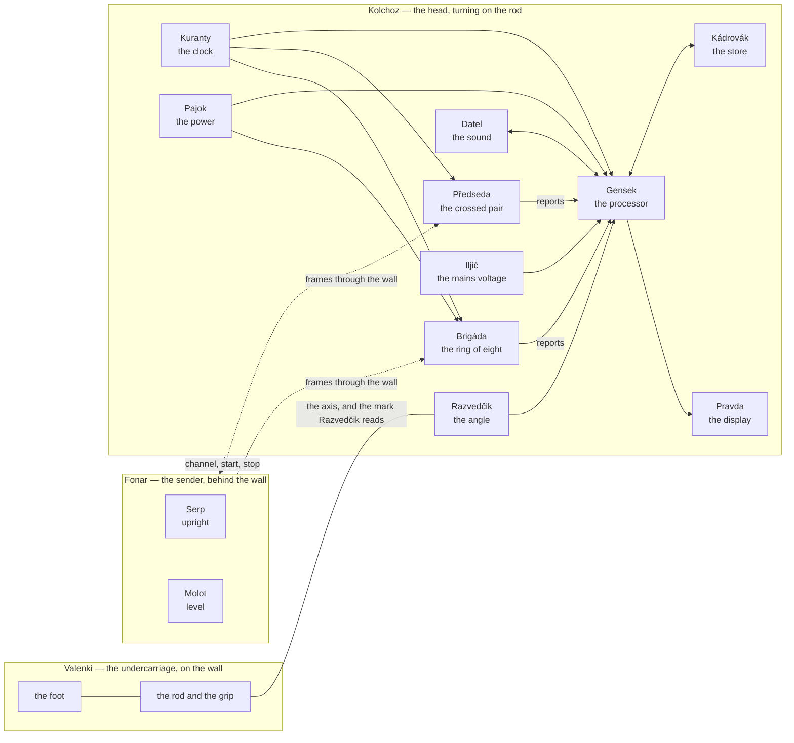

# NIC-Sluchalo — the architecture

*Level 3 of the project, closed on 13 Nov 2026, reopened the same day ([`WHY.md`](WHY.md)) and
closed again on 14 Nov 2026: the bodies, the units and what passes between them. No part types,
no packages, no processors — those are level 5, and for now in [`concept.md`](concept.md). What
the tool is for is in [`purpose.md`](purpose.md), what it must do in
[`requirements.md`](requirements.md).*

## Three bodies

The tool is three bodies. **Fonar**, the sender, stands behind the wall. **Valenki**, the
undercarriage, is held to the near face: everything that stands and does not turn. **Kolchoz**,
the head, turns on Valenki's rod just off the wall: everything that turns. Between Fonar and
Kolchoz there is only radio; between Valenki and Kolchoz, a bearing.

Each body is made of units, and a unit is whole — what senses, the electronics behind it, and its
share of the arithmetic go under one name.

## The bodies

| body | what it is | what it does not |
|---|---|---|
| **Fonar** | the sender's box: sends frames through the wall from two crossed senders taking turns; every frame says which of them it came from and carries a counter; goes to the channel the head names | measure anything; know anything about the wall |
| **Valenki** | the undercarriage: the foot that is pressed to the wall, stands firm there and holds the head off it and square to it; the rod; the grip | turn; carry anything electrical |
| **Kolchoz** | the head: the disc that turns on the rod, with the two boards and every unit below; faced with felt where it may brush the wall, so that it slides and marks nothing | rest on the wall |

## The units

In Fonar:

| unit | what it does |
|---|---|
| **Serp**, **Molot** | the two senders, crossed: one upright, one level |

In Kolchoz:

| unit | what it does | what it does not |
|---|---|---|
| **Brigáda** | the ring of eight receivers, each with its own antenna facing the wall; each measures the channel of every frame and sends a reduced report | compute the picture; keep anything |
| **Předseda** | the crossed pair in the middle of the ring, two receivers more; listens as the eight do; when the head calibrates itself by sending, it sends first | — |
| **Kuranty** | the clock: one source for all ten receivers and for Gensek, so that their phases can be compared and everything counts the same time | — |
| **Datel** | the sound: taps the wall through the middle of the head and hears its surface with a ring of microphones, the head held still | work while the head turns |
| **Razvedčik** | the angle: reads how far the head has turned on the rod | know where on the wall the rod stands |
| **Iljič** | the mains voltage: senses the electric field at the wall, amplifies it with a gain and in a band the user sets, and gives its layer of the picture | say that a cable is dead; say where to the centimetre |
| **Gensek** | the processor: tells the receivers what to do, collects their reports, the angle, the microphones and Iljič's signal; levels the receivers; computes the layers of the picture; draws them; stores them; takes the user's settings | any radio work |
| **Pravda** | the display and the buttons: show the picture; set the contrast, the thresholds and the layer | — |
| **Kádrovák** | the store: keeps every picture with its raw data; gives them to a computer | — |
| **Pajok** | the power: the battery and its charging; one supply for the radios, one for the rest | — |
| **Gradusnik** | the heat: a thermal sensor — postponed, nothing reserved for it | — |

Kolchoz's two boards: **Front** faces the wall, **Tyl** is behind it.

## What passes between them

| from | to | what | over what |
|---|---|---|---|
| Fonar | Brigáda, Předseda | frames: Serp or Molot, a counter | radio, through the wall |
| Kolchoz | Fonar | channel, start, stop | radio, the same kind of frame |
| Předseda, Brigáda | each other | Samokritika's frames, receiver to receiver — when it is run | radio, across the head's face |
| Kuranty | each receiver, Gensek | one frequency, lines of equal length | a line each, from one buffer |
| Gensek | each receiver | channel, gain, start on a common edge, send; a new program | a serial link each; a reset and a start line shared by all |
| each receiver | Gensek | a report for every frame: which frame, the channel measured, reduced | the same serial link |
| Gensek | Datel | the knock's timing | a drive signal |
| Datel | Gensek | the microphones' streams | digital streams and their clock |
| Valenki | Kolchoz | the axis the head turns on; the mark Razvedčik reads | a bearing; nothing electrical |
| Razvedčik | Gensek | the head's angle | a serial bus |
| Iljič | Gensek | the amplified field | an analog signal |
| Gensek | Pravda | the picture | a parallel bus |
| Pravda | Gensek | the user's settings | lines |
| Gensek | Kádrovák | pictures with raw data | — |
| Kádrovák | a computer | Samizdat: the pictures out; programs in | a cable |
| Pajok | every unit in Kolchoz | two supplies | — |

## How a picture comes to be

1. **Stand** — Valenki is pressed to the wall and holds Kolchoz off it.
2. **Turn** — Kolchoz goes once round the rod; Fonar sends; every receiver reports every frame;
   Razvedčik gives the angle of each.
3. **Level** — each receiver is set against its own circle: over a whole turn a wall with nothing
   laid in rings about the rod looks the same to all of them, so what differs is the receiver.
4. **Draw** — the radio layer; the voltage layer on it; the sound layer where the head stood still
   and knocked.
5. **Keep** — the picture and what it was made from go to Kádrovák.

**Samokritika** — the receivers calibrating one another by sending in turn — is the other way to
step 3, and the check on it; not a required step (the owner, 14 Nov 2026).

## The body

Valenki stands on the wall, its rod running out to the grip. Kolchoz is a disc on that rod, off
its own centre. Front faces the wall with the antennas, the receivers right behind them, Kuranty
and Datel's microphones; Tyl, behind it, carries Gensek, Pajok, Datel's knock and Pravda. On the
head an arrow for where a turn begins and ends; on its rim, notches to mark the wall by when it
has stopped.

## The names

In the spirit of the tale the tool is named after, and meant as a joke. They are settled here and
not changed below this level.

| | name | from | what it is |
|---|---|---|---|
| the tool | **Sluchalo** | the listener of *The Flying Ship* | all of it |
| a body | **Fonar** | the lantern | the sender behind the wall |
| a body | **Valenki** | felt boots | the undercarriage: all that stands |
| a body | **Kolchoz** | the collective farm | the head: all that turns |
| in Fonar | **Serp**, **Molot** | the sickle, the hammer | the two crossed senders |
| in Kolchoz | **Brigáda** | the work brigade | the ring of eight receivers that work as one |
| in Kolchoz | **Předseda** | Czech: the chairman | the crossed pair in the middle |
| in Kolchoz | **Kuranty** | the Kremlin's chimes | the one clock everything goes by |
| in Kolchoz | **Datel** | Czech: the woodpecker, after the Duga radar | the sound unit |
| in Kolchoz | **Razvedčik** | the scout | the angle unit |
| in Kolchoz | **Iljič** | Ilyich's lamp, the electrification | the mains-voltage unit |
| in Kolchoz | **Gensek** | the general secretary | the processor |
| in Kolchoz | **Pravda** | the newspaper | the display and the buttons |
| in Kolchoz | **Kádrovák** | Czech: the keeper of everyone's file | the store |
| in Kolchoz | **Pajok** | the ration | the power |
| in Kolchoz | **Gradusnik** | the thermometer | the heat unit, postponed |
| a board | **Front**, **Tyl** | the front, the rear | the board at the wall, the board behind it |
| a way of doing | **Samokritika** | self-criticism | the calibration by sending: each speaks in turn, the others listen |
| a way of doing | **Samizdat** | what gets out | taking the pictures out to a computer |
| beside the tool | **Bukvar** | the primer | the book of examples the picture is learnt from |

Not yet named: the levelling of the receivers from the pass.

## The words

| word | meaning |
|---|---|
| frame | one radio packet from a sender |
| report | what one receiver measured on one frame, reduced, as it goes to Gensek |
| layer | one kind of picture of the same piece of wall: radio, voltage, sound |
| picture | the layers together, with the raw data they were made from |
| pass | one turn of Kolchoz about the rod |
| level | to set the receivers against one another from a pass |
| grain | what the wall itself shows in a picture: joints, stones, noise |

## Open at this level

- **Where the rod stands on the head** — left to the prototype, which takes it in several places.
- **Whether a motor turns the head** — a thought.
- **Where Iljič senses** — on the axis it gives a number, off it it draws a circle.
- **How often the channel can change.**
