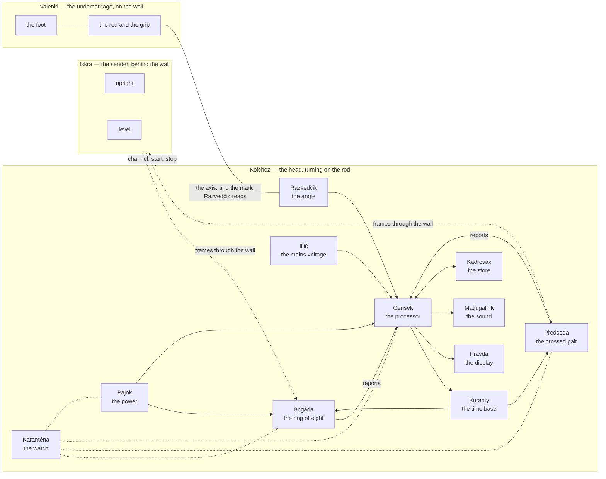

# NIC-Sluchalo — the architecture

*Level 3 of the project, closed on 13 Nov 2026, reopened the same day, closed again on 14 Nov,
reopened the same day for the head without a shared clock, and closed again on 14 Nov 2026
([`WHY.md`](WHY.md)): the bodies, the units and what passes between them. No part types, no materials, no packages, no
processors — those are level 5, and for now in [`concept.md`](concept.md). What
the tool is for is in [`purpose.md`](purpose.md), what it must do in
[`requirements.md`](requirements.md).*

## Iskra and Fonar

**Sluchalo** is the project. It is two things: **Iskra**, the sender, which lights the wall from
behind, and **Fonar**, the tool held to the near face. Fonar is two bodies: **Valenki**, the
undercarriage — everything that stands and does not turn — and **Kolchoz**, the head, which turns
on Valenki's rod just off the wall — everything that turns. Between Iskra and Fonar there is only
radio; between Valenki and Kolchoz, a bearing.

Each body is made of units, and a unit is whole — what senses, the electronics behind it, and its
share of the arithmetic go under one name.

## The bodies

| body | what it is | what it does not |
|---|---|---|
| **Iskra** | the sender's box, behind the wall: sends frames through it from two crossed senders taking turns, one upright, one level; every frame says which of them it came from and carries a counter; goes to the channel Kolchoz names | measure anything; know anything about the wall |
| **Valenki** | the undercarriage: the foot that is pressed to the wall, stands firm there and holds the head off it and square to it; the rod; the grip | turn; carry anything electrical |
| **Kolchoz** | the head: the disc that turns on the rod, with Front, Tyl and every unit below; faced with felt where it may brush the wall, so that it slides and marks nothing | rest on the wall |

## The units

In Kolchoz:

| unit | what it does | what it does not |
|---|---|---|
| **Brigáda** | the ring of eight receivers, the **Mužíci**, each with its own antenna facing the wall; each measures the channel of every frame and reports it | compute the picture; keep anything |
| **Předseda** | the chairman in the middle of the ring: two antennas at right angles to each other, round the middle, one to each of its two receivers, so that the middle measures both components of the field — the work of two Mužíci at once. It holds **Serp** in one hand and **Molot** in the other, the only senders in Fonar, and with them hands out the calibration | — |
| **Kuranty** | the time base: one edge from Gensek on a line shared by Brigáda and Předseda, ten receivers, each catching it in its own timer, so that every report carries the same time | make the receivers' phases comparable — each runs on its own crystal |
| **Razvedčik** | the angle: reads how far the head has turned on the rod | know where on the wall the rod stands |
| **Iljič** | the mains voltage, in a mode of its own: the tool held by its grip like a tester, a light where it senses; it picks up the electric field at the wall — the mains, or the signals of cable tracers on their own frequencies, several at once — with a gain and in a band the user sets, and tells it by sound, a bar and the display | say that a cable is dead; say where to the centimetre |
| **Gensek** | the processor: tells the receivers what to do, collects their reports, the angle and Iljič's signal; draws the radio layer from the amplitudes — self-scaled, levelled, focused; computes the other layers; draws them; stores them; takes the user's settings | any radio work |
| **Karanténa** | the watch: its **Felčar** keeps checking every unit while the tool runs — that every receiver reports, that its gain and noise are sane and it agrees with its neighbours, the time base, the supplies, the warmth; on a fault Karanténa declares it on Pravda and the tool stops measuring | carry on with a unit that has failed |
| **Pravda** | the display and the buttons: show the picture; set the contrast, the thresholds and the layer | — |
| **Matjugalnik** | the sound: tells by ear what the picture shows and what Iljič hears, in a tone and a loudness the user sets, so that a turn can be heard as well as seen; silent while Iljič measures | — |
| **Kádrovák** | the store: keeps every picture with its raw data; gives them to a computer | — |
| **Pajok** | the power: the battery and its charging; one supply for the radios, one for the rest | — |
| **Gradusnik** | the heat: a thermal camera, to show which cable has carried a load — postponed, nothing reserved for it; for now a thermal camera beside the tool | — |

Kolchoz has a face and a board: **Front**, the face towards the wall that carries the antennas and
shields what is behind them, and **Tyl**, the board behind it.

## What passes between them

| from | to | what | over what |
|---|---|---|---|
| Iskra | Brigáda, Předseda | frames: upright or level, a counter | radio, through the wall |
| Kolchoz | Iskra | channel, start, stop | radio, the same kind of frame |
| Předseda (Serp, Molot) | Brigáda | Samokritika's frames, one in each polarization | radio, across the head's face |
| Gensek | Kuranty, every receiver | the sync edge | one line shared by all |
| Gensek | each receiver | channel, gain, send; a new program | a serial link each; a reset and a boot line shared by all |
| each receiver | Gensek | a report for every frame: which frame, the time, the channel measured | the same serial link |
| every unit | Karanténa | its state, as Felčar asks for it | the links above |
| Valenki | Kolchoz | the axis the head turns on; the mark Razvedčik reads | a bearing; nothing electrical |
| Razvedčik | Gensek | the head's angle | a serial bus |
| Iljič | Gensek | the amplified field | an analog signal |
| Gensek | Pravda | the picture | a parallel bus |
| Gensek | Matjugalnik | the sound | a digital audio stream |
| Pravda | Gensek | the user's settings | lines |
| Gensek | Kádrovák | pictures with raw data | — |
| Kádrovák | a computer | Samizdat: the pictures out; programs in | a cable |
| Pajok | every unit in Kolchoz | two supplies | — |

## How a picture comes to be

1. **Stand** — Valenki is pressed to the wall and holds Kolchoz off it.
2. **Samokritika** — Předseda swings Serp, then Molot: a short frame in each polarization, and every
   Mužík measures how much of it arrives. Set against the state stored when the tool was last
   known good, it shows what a knock, damp or a shifted antenna has done to each Mužík; Gensek
   scales by it, and Felčar takes it as a check. Amplitudes only: with no shared clock it says
   nothing of the delays between Mužíci.
3. **Turn** — Kolchoz goes once round the rod; Iskra sends; every receiver reports every frame;
   Razvedčik gives the angle of each.
4. **Scale** — only the amplitudes are used, each receiver's gain held fixed. In every receiver
   Iskra's upright frame is set against its level one, which cancels the receiver's gain; on every
   frame the receivers are set against one another, which cancels the sender and the room; over a
   whole turn each receiver is set against its own circle.
5. **Draw** — the picture, focused as an in-line hologram with Iskra's wave as its reference.
6. **Keep** — the picture and what it was made from go to Kádrovák.

Samokritika is a regular step; the picture does not hang on it — the turn's own scaling (step 4)
draws it without.

## The body

Valenki stands on the wall, its rod running out to the grip. Kolchoz is a disc on that rod, off
its own centre. Front faces the wall: a metal disc with a thin insulating face, the antennas on
that face, each turned radially — they are of a kind made to sit over metal, and the disc is their
ground and the shield behind them. Behind Front sit the eight Mužíci and Předseda's two receivers,
each joined to its antenna by a short cable through Front; behind them Tyl carries Gensek, Pajok,
Pravda and Matjugalnik. On the head an arrow for where a turn begins and ends; on its rim,
notches to mark the wall by when it has stopped. Levša is all of it that is metal and plastic.

## The names

In the spirit of the tale the tool is named after, and meant as a joke. They are settled here and
not changed below this level.

| | name | from | what it is |
|---|---|---|---|
| the project | **Sluchalo** | the listener of *The Flying Ship* | Iskra and Fonar |
| the sender | **Iskra** | the spark, and the Bolsheviks' paper | the sender behind the wall |
| the tool | **Fonar** | the lantern | what is held to the wall: Valenki and Kolchoz |
| a body | **Valenki** | felt boots | the undercarriage: all that stands |
| in Valenki | **Kuří nožka** | Czech: the chicken leg Baba Yaga's hut turns on | the rod with its rubber foot, the axis Kolchoz turns about |
| the construction | **Levša** | Leskov's left-handed smith of Tula, who shod a steel flea | everything of metal and plastic that holds the units: Front's disc and its face, Kolchoz's housing, Valenki's foot, rod and bearing |
| a body | **Kolchoz** | the collective farm | the head: all that turns |
| in Kolchoz | **Brigáda** | the work brigade | the ring of eight receivers that work as one |
| in Brigáda | **Mužík** | a peasant | one of the eight receivers of the ring |
| in a Mužík's hands | **Kosa** | the scythe | its antenna |
| in Kolchoz | **Předseda** | Czech: the chairman | the crossed pair in the middle; does the work of two Mužíci |
| in Předseda's hands | **Serp**, **Molot** | the sickle, the hammer | the senders of Samokritika, one in each hand |
| in Kolchoz | **Kuranty** | the Kremlin's chimes | the one time everything goes by |
| in Kolchoz | **Razvedčik** | the scout | the angle unit |
| in Kolchoz | **Iljič** | Ilyich's lamp, the electrification | the mains-voltage unit |
| in Kolchoz | **Gensek** | the general secretary | the processor |
| in Kolchoz | **Pravda** | the newspaper | the display and the buttons |
| in Kolchoz | **Matjugalnik** | Russian soldiers' slang for a loudhailer, from *mat*, swearing | the sound |
| in Kolchoz | **Kádrovák** | Czech: the keeper of everyone's file | the store |
| in Kolchoz | **Pajok** | the ration | the power |
| in Kolchoz | **Karanténa** | quarantine | the watch over every unit; it stops the tool on a fault |
| in Karanténa | **Felčar** | the village medic | the checks Karanténa runs |
| in Kolchoz | **Gradusnik** | the thermometer | the thermal camera, postponed |
| in Kolchoz | **Front**, **Tyl** | the front, the rear | the face at the wall with the antennas, the board behind it |
| a way of doing | **Samokritika** | self-criticism | the chairman swings sickle and hammer, the peasants report what reached them |
| a way of doing | **Samizdat** | what gets out | taking the pictures out to a computer |
| beside the tool | **Bukvar** | the primer | the book of examples the picture is learnt from |

Not yet named: the levelling of the receivers from the pass, and the self-scaling.

## The words

| word | meaning |
|---|---|
| frame | one radio packet from a sender |
| report | what one receiver measured on one frame, as it goes to Gensek |
| picture | what one turn draws of the wall, with the raw data it was made from |
| pass | one turn of Kolchoz about the rod |
| level | to set the receivers against one another from a pass |
| grain | what the wall itself shows in a picture: joints, stones, noise |

## Open at this level

- **Where the rod stands on the head** — left to the prototype, which takes it in several places.
- **Whether a motor turns the head** — a thought.
- **Where on the head Iljič senses** — by the rim, where the light shows it.
- **How often the channel can change.**
- **Which module a receiver is** — level 5.
