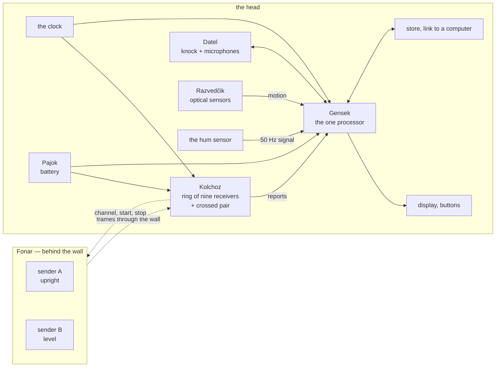

# NIC-Sluchalo — the architecture

*Level 3 of the project: the blocks and what passes between them. No part types, no packages, no
processors — those are level 5, and for now in [`concept.md`](concept.md). What the tool is for is
in [`purpose.md`](purpose.md), what it must do in [`requirements.md`](requirements.md).*

## Two things

**Fonar**, the sender, stands behind the wall. **The head** is held against the near face. Nothing
joins them but radio.

## The blocks

| block | what it does | what it does not |
|---|---|---|
| **Fonar** | sends frames through the wall, in two polarizations taking turns; every frame says which sender it came from and carries a counter; goes to the channel the head names | measure anything; know anything about the wall |
| **Kolchoz** | eleven receivers, each with its own antenna facing the wall — nine in a ring, two on a crossed pair in the middle; each measures the channel of every frame and sends a reduced report; the crossed pair, and each receiver in turn, also sends the short frames the head calibrates itself with | compute the picture; keep anything |
| **the clock** | one source for all eleven receivers and for Gensek, so that their phases can be compared and everything counts the same time | — |
| **Datel** | taps the wall through the middle of the head and hears its surface with a ring of microphones, the head held still | work while the head moves |
| **Razvedčik** | watches the wall's surface and reports how the head has moved over it | know where on the wall the head is in absolute terms |
| **the hum sensor** | picks up the mains' field at the wall — voltage, current, or both | say that a cable is dead |
| **Gensek** | the one processor: tells the receivers what to do, collects their reports, the motion, the microphones and the hum; computes the layers of the picture; draws them; stores them; takes the user's settings | any radio work |
| **the display and the buttons** | show the picture; set the contrast, the thresholds and the layer | — |
| **the store** | keeps every picture with its raw data; gives them to a computer | — |
| **Pajok** | the battery and its charging; one supply for the radios, one for the rest | — |
| **Gradusnik** | the thermal sensor — postponed, nothing reserved for it | — |

## What passes between them

| from | to | what | over what |
|---|---|---|---|
| Fonar | Kolchoz | frames: sender A or B, a counter | radio, through the wall |
| Kolchoz | Fonar | channel, start, stop | radio, the same kind of frame |
| Kolchoz | Kolchoz | calibration frames, receiver to receiver | radio, across the head's face |
| the clock | each receiver, Gensek | one frequency, lines of equal length | a line each, from one buffer |
| Gensek | each receiver | channel, gain, start on a common edge, calibrate, send; a new program | a serial link each; a reset and a start line shared by all |
| each receiver | Gensek | a report for every frame: which frame, the channel measured, reduced | the same serial link |
| Gensek | Datel | the knock's timing | a drive signal |
| Datel | Gensek | the microphones' streams | digital streams and their clock |
| Razvedčik | Gensek | motion since the last reading | a serial bus |
| the hum sensor | Gensek | the amplified field | an analog signal |
| Gensek | the display | the picture | a parallel bus |
| the buttons | Gensek | the user's settings | lines |
| Gensek | the store, a computer | pictures with raw data; programs in | a cable to the computer |
| Pajok | everything | two supplies | — |

## How a picture comes to be

1. **Calibrate** — the crossed pair sends, the ring listens, then each receiver in turn: the
   receivers' own phases fall out. Done again after every change of channel, because a receiver
   locks to a new channel at a new phase.
2. **Scan** — Fonar sends; every receiver reports every frame; Gensek divides receiver by
   receiver, so that whatever the sender did falls out and the wall is left.
3. **Place** — Razvedčik's motion says where each report was taken.
4. **Draw** — the radio layer grows under the hand; the hum layer lies on it; the sound layer is
   added where the head stood still and knocked.
5. **Keep** — the picture and what it was made from go to the store.

## The body

Two boards, one behind the other. The front one faces the wall: the antennas, the receivers right
behind them, the clock, the microphones, the optical sensors. The back one carries Gensek, the
power, the knock and the display. Between the front board and the wall, a foam spacer with a
sheet that slides; on the rim, notches to mark the wall by.

## The words

| word | meaning |
|---|---|
| frame | one radio packet from a sender |
| report | what one receiver measured on one frame, reduced, as it goes to Gensek |
| calibration | finding the receivers' own phases and gains, over the air |
| layer | one kind of picture of the same piece of wall: radio, hum, sound |
| picture | the layers together, with the raw data they were made from |
| pass | one movement of the head that yields a picture — a turn on the spot, or a stroke |
| grain | what the wall itself shows in a picture: joints, stones, noise |

## Open at this level

- **A turn or a stroke** — whether Razvedčik must give the path or only the angle (level 4, with
  the three cases of the head computed side by side).
- **The hum sensor's form** — a plate for voltage, a loop for current, or both; one sensor or
  several around the head; and its name.
- **How often the channel can change**, with a calibration after each change.
