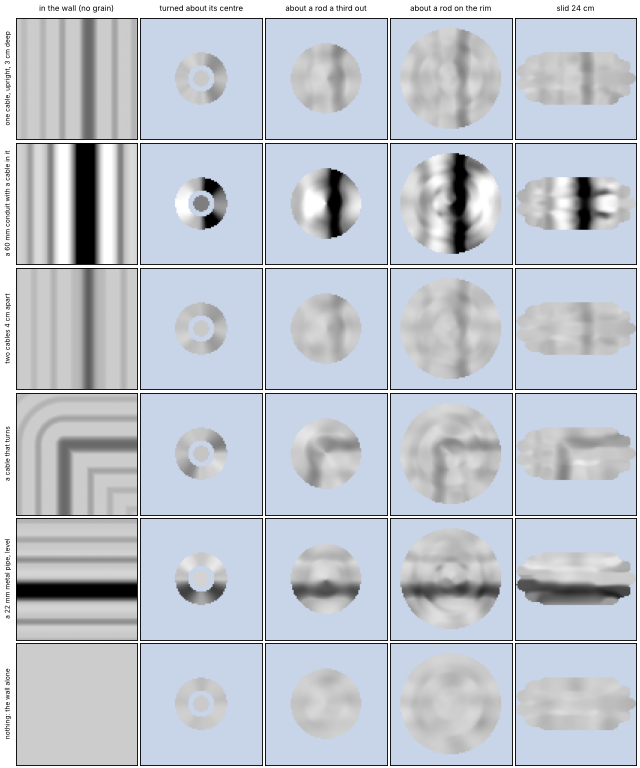
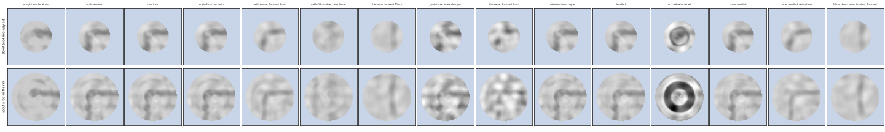

# NIC-Sluchalo — the principle

*Level 4 of the project, begun on 13 Nov 2026 and not closed: for every block the physics and a
rough calculation, always as a script in [`calc/`](calc). No part numbers. Every figure lives in
its script's output; this page says what the figures mean and points at them. The blocks and
their names are in [`architecture.md`](architecture.md).*

| block | its script | state |
|---|---|---|
| Fonar, the wall, the shadow | `budget.py`, `shadow.py`, `wall_fdtd.py`, `joints.py` | as in [`concept.md`](concept.md) |
| Kolchoz's antennas | `head.py`, `patch_fdtd.py`, `array.py` | as in the concept; the coupling between patches not computed |
| **the pass and the picture** | **`picture.py`** | **below** |
| Samokritika | — | to be scripted |
| Kuranty | `budget.py` | as in the concept |
| Datel | `acoustics.py` | as in the concept |
| the angle of the head | `picture.py` | below |
| Iljič | — | to be scripted |
| Gensek's load | `cpu.py` | to be redone once the picture's arithmetic is settled |
| Pajok | `budget.py` | as in the concept |

## The pass: the head is turned, not slid

Eleven receivers are eleven points; a picture is a few hundred. The rest comes from moving the
head, and the simplest movement is a turn: a rod with a rubber tip is pressed to the wall with one
hand, the head — a disc on that rod — is turned about it with the other. The rod is plastic and
stands off the head's centre, so that each of the nine patches of the ring lies at its own
distance from it and draws its own circle.

## The picture

`picture.py` draws what the head would show of six walls for four ways of moving it. It is a
model and not a wall: a plane wave through brick, each object the exact field of a cylinder, the
wall's grain made up to the size `joints.py` found for dry mortar, the patch taken as an average
over its own area. It leaves out the wall's surface and the head's ground plane (`head.py` has
those), the room, the wall's own change of polarization, the other channels and 5 GHz. It shows
what a way of moving the head can give at best. The figures are in `calc/picture.out`.

*Left, what is in the wall; then the head turned about its centre, about a rod a third of the way
out, about a rod on its rim, and slid. Amplitude only, both senders.*

*The cable that turns, the rod a third out (above) and on the rim (below), one thing changed at a
time.*

What the model says:

1. **About its own centre the head draws a ring and nothing else** — all nine patches run on one
   circle.
2. **About a rod off the centre it fills a disc.** A third of the way out the disc is the smaller
   and the denser; on the rim it is half as wide again, and coarser.
3. **A single cable a few centimetres deep is a faint line, about as strong as the wall's own
   grain.** It is seen because it is straight and long and the grain is not — which is what the
   purpose asks of the picture. A conduit and a pipe are strong.
4. **Both senders are needed.** With Serp alone every object that runs the other way is gone.
5. **The grain is the limit, not the noise.** Ten times the noise changes nothing, and one turn
   gives the same picture as three.
6. **The angle can come from the radio alone**: Serp and Molot are linear and the nine patches
   radial, so the ring's pattern turns with the head. In the model the error stays within a degree
   or two and the picture is the same as with a sensor. The model has no wall that turns the
   polarization, so this is the best case.
7. **The phase earns its keep on deep objects.** Carried back through the wall, a cable ten
   centimetres deep comes out of the grain; at three centimetres it adds nothing, and under a
   strong grain it harms — though the grain's phase here is a guess.
8. **A receiver's leftover gain error draws a ring about the rod**, and a stripe along a slide.
   Nothing in a wall runs in circles about our rod, so the rings can be levelled out receiver by
   receiver; a stripe along a slide looks like a pipe.
9. **Two cables four centimetres apart are not told apart** — and here the model is weak as well:
   it adds the two fields and leaves out what one cable does to the other.

Where the rod stands is left to the prototype, which takes the rod in several places. Open:
whether the rings are levelled; the same pictures with the head's
ground plane and the wall's surface in them.
